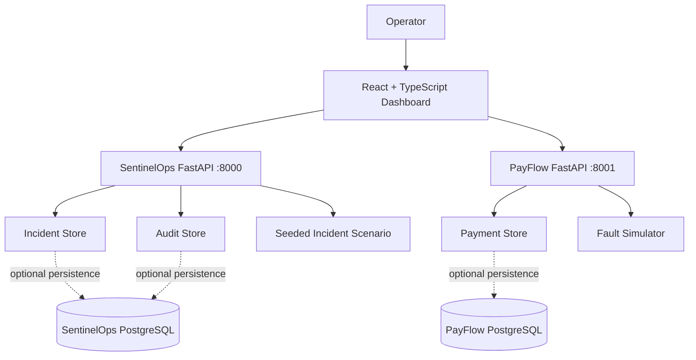

# SentinelOps

### Cloud Incident Intelligence & Reliability Engineering Workspace

**Observe. Investigate. Decide. Recover.**

SentinelOps is a local-first reliability engineering platform built around a simulated payment application called **PayFlow**. It provides an incident investigation dashboard, evidence-backed incident scenarios, an operator approval and audit workflow, and a payment API with controlled fault injection.

The project is being developed toward an AI-assisted Site Reliability Engineering (SRE) platform that can correlate operational signals, investigate probable root causes, recommend recovery actions and verify service restoration.

[](https://www.python.org/)
[](https://react.dev/)
[](https://www.typescriptlang.org/)
[](https://fastapi.tiangolo.com/)
[](https://www.postgresql.org/)
[](LICENSE)

> **Project status:** Local MVP in active development. The current implementation includes a working dashboard, two FastAPI services, optional PostgreSQL persistence and controlled PayFlow fault simulation. Live observability, LLM-based RCA and Kubernetes recovery execution are planned extensions.

---

## 1. The problem

Modern cloud-native applications consist of interconnected services. When something fails, engineers often need to inspect several different systems to understand what happened.

An incident investigation may involve:

- Application errors and request latency.
- CPU and memory utilization.
- Database connection failures.
- Kubernetes pod health.
- Deployment history.
- Service dependencies.
- Recovery decisions and audit records.

When this information is fragmented, identifying the probable root cause and restoring service can take longer than necessary.

**SentinelOps aims to bring this investigation workflow into one engineering workspace.**

## 2. How SentinelOps works

The intended reliability workflow is:

```text
       APPLICATION DEPLOYMENT
                 |
                 v
          OBSERVE SYSTEM
                 |
                 v
           DETECT FAILURE
                 |
                 v
         CORRELATE EVENTS
                 |
                 v
        INVESTIGATE CAUSE
                 |
                 v
       RECOMMEND RECOVERY
                 |
                 v
          HUMAN REVIEW
                 |
                 v
       EXECUTE & VERIFY
                 |
                 v
         RECORD OUTCOME
```

The current MVP implements the incident review, seeded investigation, approval/audit workflow and PayFlow fault simulation portions of this lifecycle.

## 3. Current implemented features

| Capability | What it does | Current status |
|---|---|---|
| Operations dashboard | Displays incident information, seeded reliability indicators and service health | Implemented |
| Incident investigation | Displays SNT-001, its timeline, hypothesis, evidence, alternatives and missing evidence | Implemented with seeded data |
| Approval workflow | Allows an operator to approve or reject proposed actions | Implemented |
| Audit trail | Records decisions, actor labels, timestamps and execution state | Implemented |
| PayFlow API | Creates, lists and retrieves payment transactions | Implemented |
| Fault simulation | Injects latency, processing errors and simulated database outages | Implemented |
| PostgreSQL persistence | Persists PayFlow transactions, incidents, decisions and audit history when configured | Implemented |

### Incident investigation: SNT-001

The MVP includes a demonstration incident:

**Payment Service Performance Regression**

Illustrative incident evidence:

| Indicator | Value |
|---|---:|
| CPU utilization | 95% |
| HTTP error rate | 28% |
| p95 API latency | 4.2 seconds |
| Pod restarts | 5 |

The investigation screen presents:

- A UTC event timeline.
- A probable root-cause hypothesis.
- Supporting evidence references.
- Alternative explanations.
- Missing evidence.
- Suggested investigation steps.
- Operational runbook recommendations.

The scenario illustrates how a recent deployment could be associated with database connection exhaustion and payment-service performance degradation.

### Recovery policy and audit workflow

Operators can review three proposed action types:

- Restart an unhealthy payment pod.
- Roll back a deployment.
- Scale payment replicas.

The current implementation supports approval and rejection decisions, not actual infrastructure execution. Decisions update the action status, add a timeline event and create an audit record.

### PayFlow fault simulation

PayFlow is a separate FastAPI service used to generate controlled application behavior.

| Fault | Simulated behavior |
|---|---|
| High latency | Adds 800 ms to payment processing |
| High error rate | Fails every other eligible request with HTTP 500 |
| Database unavailable | Returns HTTP 503 |

The payment API records failed attempts as well as successful transactions. This makes it possible to inspect the behavior through the dashboard and API.

## 4. Important implementation boundaries

SentinelOps is under active development. The following distinctions are intentional:

| Capability | Current behavior |
|---|---|
| Incident evidence | Seeded demonstration evidence |
| Reliability charts | Seeded incident-window metrics and latency values |
| Root cause analysis | Deterministic seeded investigation; no LLM call yet |
| Recovery approval | Implemented |
| Kubernetes recovery execution | Not implemented |
| Recovery verification | Not implemented |
| Live Prometheus / Loki / Tempo ingestion | Not implemented |
| Automatic incident detection | Not implemented |

The project roadmap describes how these capabilities will be developed.

## 5. Architecture



### Architecture overview

**Dashboard**

A React and TypeScript application that communicates independently with the SentinelOps API and PayFlow API.

**SentinelOps API**

A FastAPI service responsible for incident records, investigation information, recovery decisions and audit history.

**PayFlow Payment Service**

A separate FastAPI application responsible for payment transactions and controlled fault simulation.

**Persistence**

Each API has its own database configuration, SQLAlchemy engine and Alembic migration history. PostgreSQL persistence is optional; omitting database URLs uses the in-memory demonstration stores.

See [docs/architecture.md](docs/architecture.md) for more implementation details.

## 6. Technology stack

| Technology | Responsibility |
|---|---|
| React 19 | Dashboard interface |
| TypeScript | Frontend type safety |
| Vite | Frontend development and build |
| Tailwind CSS | UI styling |
| Python | Backend development |
| FastAPI | REST APIs |
| Pydantic | Request and response validation |
| SQLAlchemy | Database access |
| Alembic | Database migrations |
| PostgreSQL | Optional persistent storage |
| Pytest | Backend testing |
| Vitest | Frontend unit testing |
| Playwright | Browser-based end-to-end testing |

## 7. Getting started

### Prerequisites

- Windows 11 with WSL2 Ubuntu, or a compatible Linux environment.
- Python 3.11 or newer.
- Node.js 22.12 or newer.
- npm.
- Git.

PostgreSQL is optional for the in-memory demonstration.

### Step 1 — Clone the repository

The current Playwright configuration expects the repository at `~/sentinelops`.

```bash
git clone https://github.com/darshsoam07/SentinelOps.git ~/sentinelops
cd ~/sentinelops
```

### Step 2 — Create the Python environment

```bash
python3 -m venv .venv
source .venv/bin/activate

python -m pip install --upgrade pip

python -m pip install \
  -r backend/api/requirements-dev.txt \
  -r applications/payflow/payment-service/requirements-dev.txt
```

### Step 3 — Install frontend dependencies

```bash
cd ~/sentinelops/dashboard

npm ci

test -f .env || cp .env.example .env
```

### Step 4 — Start the applications

Open three Ubuntu terminals.

**Terminal 1 — PayFlow API**

```bash
cd ~/sentinelops/applications/payflow/payment-service

source ~/sentinelops/.venv/bin/activate

uvicorn app.main:app --reload --port 8001
```

**Terminal 2 — SentinelOps API**

```bash
cd ~/sentinelops/backend/api

source ~/sentinelops/.venv/bin/activate

uvicorn app.main:app --reload --port 8000
```

**Terminal 3 — React dashboard**

```bash
cd ~/sentinelops/dashboard

npm run dev
```

### Step 5 — Open the application

| Component | URL |
|---|---|
| React dashboard | http://localhost:5173 |
| SentinelOps API | http://localhost:8000 |
| SentinelOps Swagger docs | http://localhost:8000/docs |
| PayFlow API | http://localhost:8001 |
| PayFlow Swagger docs | http://localhost:8001/docs |

## 8. Optional PostgreSQL persistence

By default, the applications use their in-memory stores.

To enable PostgreSQL persistence in WSL2 Ubuntu:

```bash
sudo apt update
sudo apt install -y postgresql openssl

sudo service postgresql start

cd ~/sentinelops

bash scripts/setup-postgres.sh
```

The script creates separate database users and databases for SentinelOps and PayFlow, generates local connection settings in `.env.postgres`, and applies the Alembic migrations.

Before starting each API, source the connection settings:

```bash
source ~/sentinelops/.env.postgres
```

With PostgreSQL enabled, payment receipts, incident decisions, timelines and audit records survive application restarts.

To verify persistence:

```bash
cd ~/sentinelops

source .venv/bin/activate
source .env.postgres

python scripts/test-persistence.py
```

The persistence test uses isolated PostgreSQL schemas and removes its test data afterward.

## 9. API reference

### SentinelOps API — Port 8000

| Method | Endpoint | Purpose |
|---|---|---|
| GET | `/health` | Health check |
| GET | `/incidents` | List incidents |
| GET | `/incidents/{id}` | Retrieve incident details |
| POST | `/incidents/{id}/approve` | Approve a proposed action |
| POST | `/incidents/{id}/reject` | Reject a proposed action |
| GET | `/audit-logs` | Retrieve audit events |
| GET | `/metrics/summary` | Retrieve seeded reliability summary |

Approval and rejection request example:

```json
{
  "action_id": "ACT-001",
  "note": "Reviewed the recommendation"
}
```

### PayFlow API — Port 8001

| Method | Endpoint | Purpose |
|---|---|---|
| GET | `/health` | Health check |
| POST | `/payments` | Create payment |
| GET | `/payments` | List payment transactions |
| GET | `/payments/{id}` | Retrieve a payment |
| GET | `/simulation/faults` | Retrieve fault configuration |
| POST | `/simulation/faults` | Enable or disable a fault |

## 10. Running tests

### Backend tests

```bash
cd ~/sentinelops

source .venv/bin/activate

(cd backend/api && python -m pytest -q)

(cd applications/payflow/payment-service && python -m pytest -q)
```

### Frontend tests and build

```bash
cd ~/sentinelops/dashboard

npm test

npm run build
```

### End-to-end browser tests

Install Chromium:

```bash
npx playwright install --with-deps chromium
```

Run the browser tests:

```bash
cd ~/sentinelops/dashboard
env -u SENTINELOPS_DATABASE_URL -u PAYFLOW_DATABASE_URL npm run test:e2e
```

Playwright starts isolated test services on ports 8100, 8101 and 5174 so that browser tests do not mutate the normal development workspace.

## 11. Repository structure

```text
SentinelOps/
│
├── applications/
│   └── payflow/
│       └── payment-service/
│           ├── app/
│           ├── alembic/
│           └── tests/
│
├── backend/
│   └── api/
│       ├── app/
│       ├── alembic/
│       └── tests/
│
├── dashboard/
│   ├── src/
│   │   ├── pages/
│   │   └── services/
│   └── tests/
│
├── docs/
│   └── architecture.md
│
├── scripts/
│   ├── setup-postgres.sh
│   └── test-persistence.py
│
├── .gitignore
├── LICENSE
└── README.md
```

## 12. Development roadmap

The following capabilities are planned extensions, not claims about the current implementation.

| Phase | Planned capability |
|---|---|
| Phase 1 | Real observability with Prometheus, Grafana, Loki, Tempo and OpenTelemetry |
| Phase 2 | Automated incident detection, event correlation and service dependency mapping |
| Phase 3 | Evidence-based AI root cause analysis and runbook retrieval |
| Phase 4 | Kubernetes recovery execution with human approval and health verification |
| Phase 5 | Controlled chaos experiments, resilience testing and incident replay |
| Phase 6 | Docker, Kubernetes, Helm, GitHub Actions and GitOps |
| Phase 7 | Terraform-based AWS deployment |

The development priority is to make each capability functional, testable and observable before adding more technologies.

## 13. Security and usage limitations

The current application is a local development and demonstration project.

- Do not expose the APIs directly to the public internet.
- The current approval interface is not an authentication system.
- Operator identity is a demonstration label.
- Fault switches are process-local.
- The incident and reliability scenario is seeded.
- Approved actions are not executed against Kubernetes.
- Do not use production payment or infrastructure data.

Restricted recovery execution, proper authentication and authorization, and production-grade security controls belong to future milestones.

## 14. Contributing

Contributions and engineering suggestions are welcome.

Before proposing a change:

1. Understand the existing service boundaries.
2. Keep the SentinelOps API and PayFlow responsibilities separate.
3. Add tests for changed behavior.
4. Update documentation when API contracts or setup instructions change.

## 15. License

This project is licensed under the [MIT License](LICENSE).

---

**SentinelOps — Building toward intelligent, evidence-driven cloud reliability engineering.**
