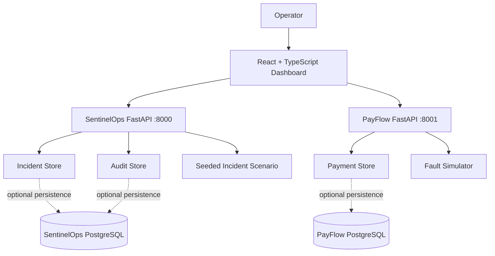
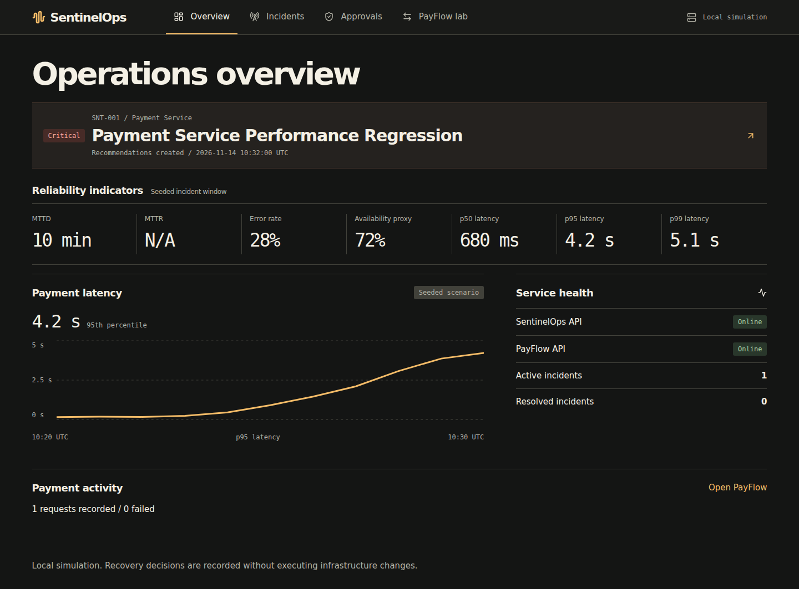
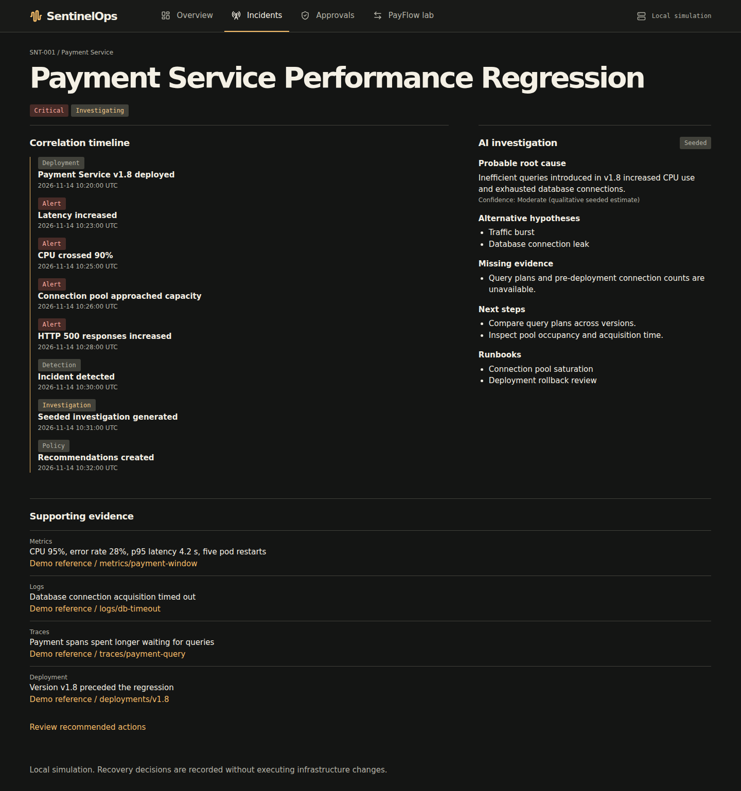
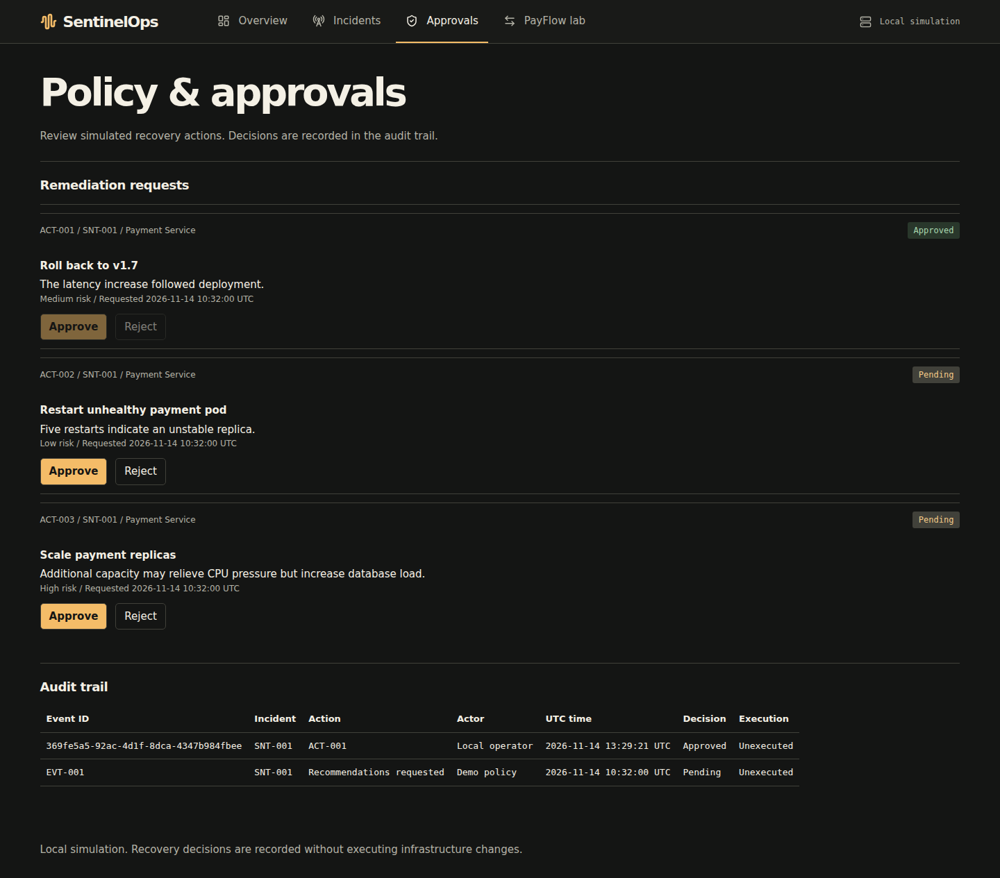
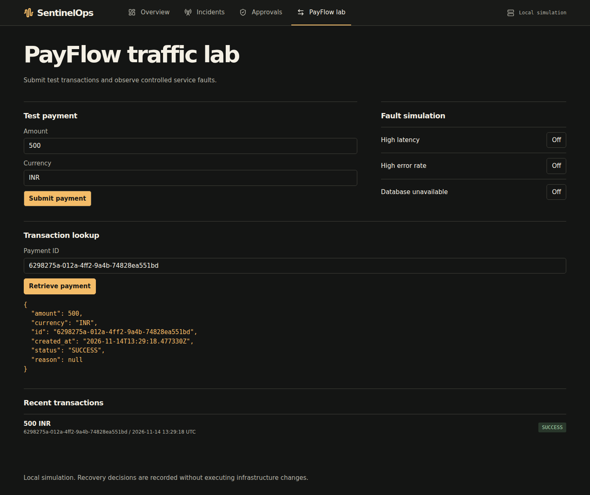

# SentinelOps — Cloud Incident Intelligence and Reliability Engineering Workspace

**Observe. Investigate. Decide. Recover.**

[](https://www.python.org/)
[](https://react.dev/)
[](https://www.postgresql.org/)
[](LICENSE)

SentinelOps gives an operator one place to investigate a PayFlow payment regression, review a proposed recovery action and see who decided it. The same workspace lets a reviewer send payments to a running API and observe how it responds to controlled faults.

> **Current status · Runnable local MVP.** Incident SNT-001 uses seeded evidence. Payment receipts, API health checks, approval decisions and audit entries come from actual HTTP requests. Both services support in-memory operation and optional PostgreSQL persistence.

## Problem statement

After a payment deployment, slow requests and database timeouts may appear together. An operator needs to establish which observations support a rollback, what evidence is missing and whether anyone has already approved the action.

## Solution and reliability workflow

The full workflow runs from observing a failure through detecting and correlating signals, investigating a cause, reviewing a recommendation, executing recovery and verifying restoration. Today's entry point is a prepared incident. The operator inspects its evidence, approves or rejects a recommendation, and checks the resulting timeline and audit history.

## Implemented features

| Capability | What a reviewer can verify today |
|---|---|
| Operations overview | Check both API processes and inspect the seeded latency window alongside counts of actual test payments. |
| Investigation | Filter incidents and open the UTC timeline, hypothesis, evidence references, alternatives, missing evidence and suggested runbooks. |
| Decision and audit | Approve or reject an allowlisted action. A second decision returns HTTP 409. The first decision appears in both the timeline and audit trail. |
| Payment traffic | Submit a positive amount and three-letter uppercase currency. Retrieve the resulting UUID receipt, including failed attempts. |
| Controlled faults | Add 800 ms of latency, fail the first and every other eligible payment with HTTP 500, or simulate a database outage with HTTP 503. |
| Persistence | Restart the APIs with PostgreSQL configured and retrieve the original receipt and decision. Each service owns its database and migrations. |

## Main demonstration · Payment Service Performance Regression (SNT-001)

1. Open **SNT-001** from Overview. Its seeded deployment timeline begins at 10:20 UTC on 14 November 2026. Detection follows at 10:30 UTC.
2. Inspect the evidence: 95% CPU, a 28% HTTP error rate, 4.2 seconds p95 latency and five pod restarts. The metrics, logs, trace references and deployment record are seeded. The deterministic investigation links the regression to possible database connection exhaustion and identifies missing query plans.
3. Open **Approvals**. Review the rollback, restart and scaling recommendations, then decide one action. Refresh the page and find its action ID in the audit trail. Execution stays unexecuted and the incident remains investigating.
4. Open **PayFlow lab**. Submit a payment, enable **Database unavailable**, and submit again. Retrieve the failed receipt by ID. Disable the fault and submit once more to observe a successful payment. These requests exercise PayFlow independently of the seeded incident.

[Incident fixture](backend/api/app/seed.py) · [Decision policy](backend/api/app/service.py) · [Payment fault behavior](applications/payflow/payment-service/app/service.py)

## Architecture



The browser calls each API independently. PostgreSQL mode commits the decision, timeline change and audit entry in one transaction under a row lock. PayFlow stores each completed payment attempt separately. [Architecture notes](docs/architecture.md) · [Dashboard HTTP client](dashboard/src/services/api.ts)

## Technology stack and responsibility

| Technology | Responsibility |
|---|---|
| React 19 | Dashboard interface |
| TypeScript | Frontend type safety |
| Vite | Frontend development and build |
| Tailwind CSS | UI styling |
| Python | Backend development |
| FastAPI | REST APIs |
| Pydantic | Request and response validation |
| SQLAlchemy | Database access |
| Alembic | Database migrations |
| PostgreSQL | Optional persistent storage |
| Pytest | Backend testing |
| Vitest | Frontend unit testing |
| Playwright | Browser-based end-to-end testing |

## Screenshots

### Operations overview



Both local APIs are online and PayFlow has recorded one test request. The reliability indicators describe the seeded incident window.

### Incident investigation



The SNT-001 timeline places the deployment before the latency increase. The seeded investigation identifies missing query plans and suggests checks for connection pool exhaustion.

### Approvals and audit



The operator approved the rollback recommendation. The audit row records the decision and shows execution as unexecuted. Two other requests await review.

### PayFlow lab



A test payment was submitted and retrieved by ID with all three simulated faults switched off.

## Local setup prerequisites

- Windows 11 with WSL2 Ubuntu, or a compatible Linux environment.
- Python 3.11 or newer.
- Node.js 22.12 or newer.
- npm.
- Git.

PostgreSQL is optional for the in-memory demonstration.

## Installation

### Clone the repository

The current Playwright configuration expects the repository at `~/sentinelops`.

```bash
git clone https://github.com/darshsoam07/SentinelOps.git ~/sentinelops
cd ~/sentinelops
```

### Step 2 — Create the Python environment

```bash
python3 -m venv .venv
source .venv/bin/activate

python -m pip install --upgrade pip

python -m pip install \
  -r backend/api/requirements-dev.txt \
  -r applications/payflow/payment-service/requirements-dev.txt
```

### Step 3 — Install frontend dependencies

```bash
cd ~/sentinelops/dashboard

npm ci

test -f .env || cp .env.example .env
```

## Starting all three applications

Open three Ubuntu terminals.

**Terminal 1 — PayFlow API**

```bash
cd ~/sentinelops/applications/payflow/payment-service

source ~/sentinelops/.venv/bin/activate

uvicorn app.main:app --reload --port 8001
```

**Terminal 2 — SentinelOps API**

```bash
cd ~/sentinelops/backend/api

source ~/sentinelops/.venv/bin/activate

uvicorn app.main:app --reload --port 8000
```

**Terminal 3 — React dashboard**

```bash
cd ~/sentinelops/dashboard

npm run dev
```

## Application URLs

| Component | URL |
|---|---|
| React dashboard | http://localhost:5173 |
| SentinelOps API | http://localhost:8000 |
| SentinelOps Swagger docs | http://localhost:8000/docs |
| PayFlow API | http://localhost:8001 |
| PayFlow Swagger docs | http://localhost:8001/docs |

## Optional PostgreSQL persistence

By default, the applications use their in-memory stores.

To enable PostgreSQL persistence in WSL2 Ubuntu:

```bash
sudo apt update
sudo apt install -y postgresql openssl

sudo service postgresql start

cd ~/sentinelops

bash scripts/setup-postgres.sh
```

The script creates separate database users and databases for SentinelOps and PayFlow, generates local connection settings in `.env.postgres`, and applies the Alembic migrations.

Before starting each API, source the connection settings:

```bash
source ~/sentinelops/.env.postgres
```

With PostgreSQL enabled, payment receipts, incident decisions, timelines and audit records survive application restarts.

To verify persistence:

```bash
cd ~/sentinelops

source .venv/bin/activate
source .env.postgres

python scripts/test-persistence.py
```

The persistence test uses isolated PostgreSQL schemas and removes its test data afterward.

The setup script runs `alembic upgrade head` from each API directory using the root virtual environment. Keep the generated connection settings outside Git. [Database setup](scripts/setup-postgres.sh)

## API reference

### SentinelOps API — Port 8000

| Method | Endpoint | Purpose |
|---|---|---|
| GET | `/health` | Health check |
| GET | `/incidents` | List incidents |
| GET | `/incidents/{id}` | Retrieve incident details |
| POST | `/incidents/{id}/approve` | Approve a proposed action |
| POST | `/incidents/{id}/reject` | Reject a proposed action |
| GET | `/audit-logs` | Retrieve audit events |
| GET | `/metrics/summary` | Retrieve seeded reliability summary |

Approval and rejection request example:

```json
{
  "action_id": "ACT-001",
  "note": "Reviewed the recommendation"
}
```

### PayFlow API — Port 8001

| Method | Endpoint | Purpose |
|---|---|---|
| GET | `/health` | Health check |
| POST | `/payments` | Create payment |
| GET | `/payments` | List payment transactions |
| GET | `/payments/{id}` | Retrieve a payment |
| GET | `/simulation/faults` | Retrieve fault configuration |
| POST | `/simulation/faults` | Enable or disable a fault |

## Running tests

### Backend tests

```bash
cd ~/sentinelops

source .venv/bin/activate

(cd backend/api && python -m pytest -q)

(cd applications/payflow/payment-service && python -m pytest -q)
```

### Frontend tests and build

```bash
cd ~/sentinelops/dashboard

npm test

npm run build
```

### End-to-end browser tests

From the dashboard directory, install Chromium:

```bash
cd ~/sentinelops/dashboard
npx playwright install --with-deps chromium
```

Run the browser tests:

```bash
cd ~/sentinelops/dashboard
env -u SENTINELOPS_DATABASE_URL -u PAYFLOW_DATABASE_URL npm run test:e2e
```

Playwright starts isolated test services on ports 8100, 8101 and 5174 so that browser tests do not mutate the normal development workspace.

## Repository structure

```text
SentinelOps/
│
├── applications/
│   └── payflow/
│       └── payment-service/
│           ├── app/
│           ├── alembic/
│           └── tests/
│
├── backend/
│   └── api/
│       ├── app/
│       ├── alembic/
│       └── tests/
│
├── dashboard/
│   ├── src/
│   │   ├── pages/
│   │   └── services/
│   └── tests/
│
├── docs/
│   └── architecture.md
│
├── scripts/
│   ├── setup-postgres.sh
│   └── test-persistence.py
│
├── .gitignore
├── LICENSE
└── README.md
```

## Current limitations and security boundaries

The current application is a local development and demonstration project.

- Do not expose the APIs directly to the public internet.
- The current approval interface is not an authentication system.
- Operator identity is a demonstration label.
- Fault switches are process-local.
- The incident and reliability scenario is seeded.
- Approved actions are not executed against Kubernetes.
- Do not use production payment or infrastructure data.

Restricted recovery execution, proper authentication and authorization, and production-grade security controls belong to future milestones.

Investigation uses deterministic fixture data and makes no LLM calls. Live OpenTelemetry ingestion, Prometheus, Grafana, Loki and Tempo integration, automatic incident detection and Kubernetes self-healing are pending. Approval records a decision without executing or verifying infrastructure changes.

## SentinelOps 2.0 roadmap

| Planned milestone | Engineering outcome |
|---|---|
| Container packaging | Run the two APIs, dashboard and databases with Docker Compose. |
| Observability and SLOs | Instrument PayFlow with OpenTelemetry, collect metrics in Prometheus, logs in Loki and traces in Tempo, and display measured reliability and error budgets in Grafana. |
| Incident correlation | Detect threshold breaches, group related events and calculate the affected services from a dependency map. |
| Evidence-based RCA | Collect incident-window evidence, retrieve runbooks and optionally use an LLM to synthesize hypotheses. |
| Kubernetes recovery | Deploy locally with Helm, execute an approved operation through restricted RBAC and verify recovery before resolving an incident. |
| Chaos engineering and replay | Run bounded experiments, clean up faults and replay the recorded incident timeline. |
| Delivery and cloud | Validate changes in GitHub Actions, reconcile deployments with Argo CD and provision an AWS environment with Terraform. |

## Contributing

Contributions and engineering suggestions are welcome.

Before proposing a change:

1. Understand the existing service boundaries.
2. Keep the SentinelOps API and PayFlow responsibilities separate.
3. Add tests for changed behavior.
4. Update documentation when API contracts or setup instructions change.

## License

Licensed under the [MIT License](LICENSE).
